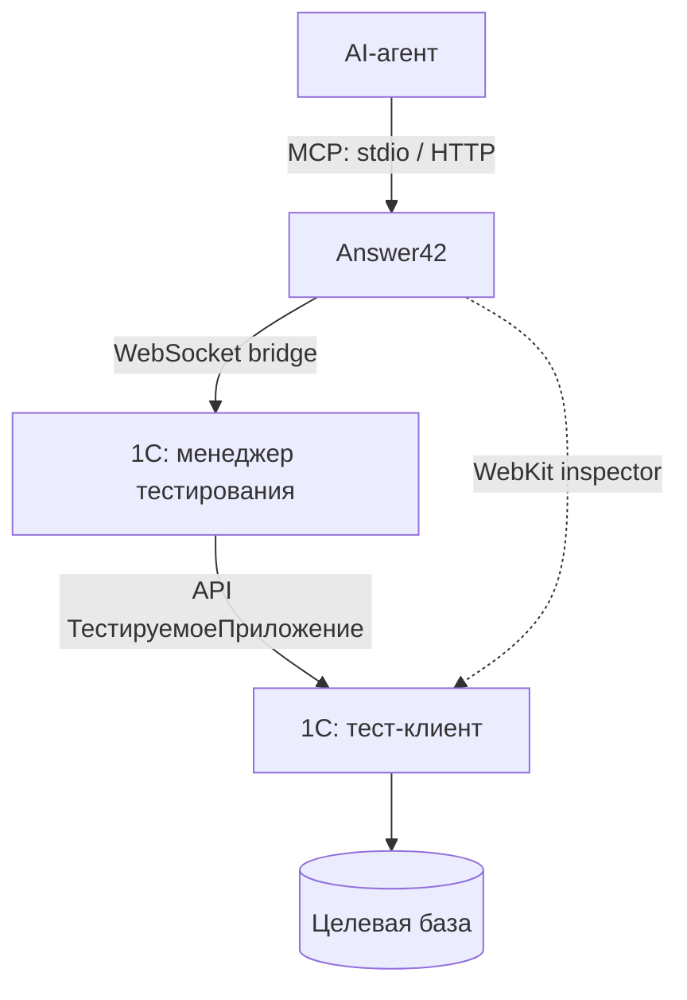

# Answer42

```{raw} html
<section class="a42-hero">
  
  <div>
    <p class="a42-kicker">The Answer to Life, Universe, and 1C — UI Driver</p>
    <p class="a42-lead">MCP-сервер, который даёт AI-агенту руки в 1С:Предприятии: открывать формы, нажимать кнопки,
      заполнять поля, работать с таблицами, списками, отчётами и веб-страницами внутри форм — через клиент тестирования,
      на Windows и Linux, в том числе без экрана.</p>
    <div class="a42-actions">
      <a class="a42-button a42-primary" href="guides/installation.html">Быстрый старт</a>
      <a class="a42-button" href="api/index.html">Справочник API</a>
      <a class="a42-button" href="https://gitlab.com/platform42/answer42-mcp">GitLab</a>
    </div>
  </div>
</section>

<div class="a42-cards">
  <a class="a42-card" href="api/group-01-core.html">
    <h3>Управление UI 1С</h3>
    <p>Формы, кнопки, поля, формы выбора, таблицы, динамические списки, табличные документы — первыми классами MCP-инструментов, а не кликами по координатам.</p>
  </a>
  <a class="a42-card" href="api/group-09-html.html">
    <h3>Живые HTML-страницы</h3>
    <p>DOM, клики, ввод и ошибки консоли веб-приложений в HTML-полях (чаты, SPA) — через встроенный WebKit клиента.</p>
  </a>
  <a class="a42-card" href="guides/overview.html#группы-инструментов">
    <h3>Группы инструментов</h3>
    <p>Клиент видит компактный набор, остальное подключается по требованию: формы, таблицы, списки, команды, RAG, запись.</p>
  </a>
  <a class="a42-card" href="api/group-10-recording.html">
    <h3>Доказательная запись</h3>
    <p>Каждый шаг — слайд с запросом, ответом и скриншотом окна 1С; в конце — PDF-отчёт.</p>
  </a>
  <a class="a42-card" href="api/group-08-rag.html">
    <h3>RAG по конфигурации</h3>
    <p>Локальный индекс метаданных EDT и XML-выгрузок с расширениями: подсказки агенту и типы элементов в <code>ui_tree</code>.</p>
  </a>
  <a class="a42-card" href="guides/architecture.html">
    <h3>Изолированные сессии</h3>
    <p>Свой менеджер тестирования, порты и дисплей на сессию: Xvfb на Linux, скрытый рабочий стол на Windows, stdio или HTTP.</p>
  </a>
</div>
```

## Установка за минуту

```bash
pipx install 'answer42[screenshot,linux-window-control]'      # Linux
pipx install "answer42[screenshot,windows-window-control]"    # Windows
answer42 credentials add --url "<TARGET_INFOBASE_URL>" --username "<USERNAME>"
answer42                                                      # MCP-сервер, transport stdio
```

Дальше агент работает одним вызовом за шаг:

```text
start_session(base_url="<TARGET_INFOBASE_URL>")
open_navigation_link("e1cib/list/Справочник.Контрагенты")
click_button(name="Создать", search_by_title=true)
set_field_value(field_name="Наименование", value="ООО Ромашка", search_by_title=true)
save_form()
stop_session()
```

## Как это работает



Answer42 поднимает менеджер тестирования 1С со своей обработкой и передаёт ему команды по WebSocket; менеджер управляет тест-клиентом через API клиента тестирования. Веб-страницы в HTML-полях Answer42 читает напрямую через встроенный WebKit клиента. Подробнее — в разделе {doc}`guides/architecture`.

```{toctree}
:caption: Руководства
:maxdepth: 1
:hidden:

guides/overview
guides/installation
guides/agent-installation
guides/releases
```

```{toctree}
:caption: Справочник API
:maxdepth: 2
:hidden:

api/index
```

```{toctree}
:caption: Для разработчиков
:maxdepth: 1
:hidden:

guides/architecture
```
