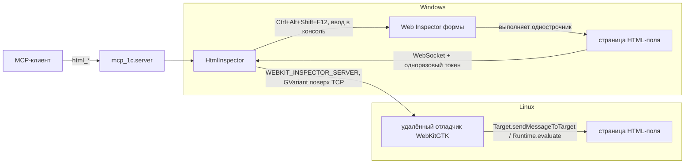

# Архитектура Answer42

<p align="center">
  
</p>

## Обзор

`Answer42` — MCP-сервер для интерактивного управления UI 1С:Предприятия через клиент тестирования.

Основные подсистемы:

1. **UI Driver** — запуск менеджера тестирования, подключение тест-клиента и выполнение интерактивных операций над формами 1С.
2. **Доказательная запись** — запись аннотированных слайдов с MCP method/request/response и скриншотом окна 1С.
3. **RAG metadata index** — SQLite/FTS индекс метаданных конфигураций и расширений 1С для подсказок агенту и обогащения `ui_tree` типами элементов формы.
4. **Мост к живым веб-страницам** — доступ к DOM и консоли страниц в HTML-полях через встроенный WebKit клиента (`mcp_1c.html_agent`).

## Сессии

Каждая сессия Answer42 изолирует процессы и временные ресурсы:

```python
class SessionState:
    session_id: str
    display: str              # X11 display (Linux) или пустая строка (Windows)
    platform_dir: Path        # путь к платформе 1С (Linux: /opt/1cv8/..., Windows: C:\Program Files\1cv8\...)
    ws_port: int              # порт WebSocket bridge
    ibsrv_port: int           # порт HTTP-gate автономного сервера (0 если file-direct fallback)
    testclient_port: int      # TCP-порт клиента тестирования
    data_dir: Path            # временная директория сессии (tempdir/answer42/sessions/{session_id})
    base_url: str
    username: str
    password: str
    xvfb_process: Popen | None
    runtime: ManagerRuntime | None
    bridge: OneCBridgeServer
    recorder: RecordingSession
```

Если `session_id` не указан в tool-вызове, используется сессия `default`.

## Общая схема

Поток выполнения:

1. **MCP-клиент** — LLM/агент вызывает MCP tools через stdio.
2. **Python MCP server Answer42** — принимает MCP-вызовы, ведёт сессии, RAG и доказательную запись.
3. **WebSocket bridge** — передаёт JSON-RPC-like команды между Python и 1С.
4. **1С test manager** — тонкий клиент с обработкой `MCPTestManager`; выполняет BSL-dispatch к API клиента тестирования.
5. **1С test client** — тестируемое приложение, подключённое к целевой информационной базе.
6. **Целевая информационная база** — база, по UI которой агент выполняет интерактивные операции.

Передача управления:

| Шаг | Откуда | Куда | Канал |
|---:|---|---|---|
| 1 | MCP-клиент | Answer42 | stdio MCP |
| 2 | Answer42 | WebSocket bridge | локальный TCP/WebSocket |
| 3 | WebSocket bridge | 1С test manager | WebSocket client из 1С |
| 4 | 1С test manager | 1С test client | API `ТестируемоеПриложение` |
| 5 | 1С test client | Целевая ИБ | стандартное подключение 1С |

## Конвейер one-shot запуска

`start_session()` выполняет полный запуск автоматически:

1. Определяет версию платформы по `base_url` или использует переданную.
2. Проверяет требование: **1С:Предприятие 8.3.27+ или 8.5+**.
3. Подбирает свободный X11 display (Linux) или пропускает (Windows).
4. Подбирает свободные TCP-порты для bridge, ibsrv и test-client.
5. Запускает Xvfb (Linux) и WebSocket bridge.
6. Создаёт файловую базу менеджера, загружает `MCPTestManager.cf`. Если `ibsrv` доступен — запускает автономный сервер и test-manager через `/WS`; если нет — запускает test-manager напрямую через `/F` (file-direct fallback).
7. Подключает клиент тестирования к `base_url` или к локальной тестовой базе, созданной для E2E. Если `username`/`password` не переданы, Answer42 ищет их в локальном credentials-файле по `base_url`; это основной безопасный режим, потому что секреты остаются в окружении MCP-процесса и не передаются агенту в аргументах tool-call. Дополнительные параметры запуска клиента передаются через `extra_args`, `execute` (`/Execute`) и `command_parameter` (`/C`); если `/C` уже есть в `extra_args`, части значения объединяются через `;`.
8. Запоминает RAG snapshot, привязанный к `base_url`, если такой snapshot уже был создан раньше.
9. Запускает idle watcher: после `idle_timeout_minutes` минут неактивности выполняется `stop_session()`.

## Python-модули

### `mcp_1c.server`

Точка входа `answer42`. Регистрирует MCP tools через `FastMCP` и управляет `SessionState`.

Группы tools:

- жизненный цикл: `start_session`, `stop_session`, `session_status`, `credentials_check`;
- автоматизация UI: `active_window`, `windows_list`, `activate_window`, `goto_window`, `ui_tree`, `find_object`, `focus_object`, `open_navigation_link`, `click_button`, `set_field_value`, `save_form`, `close_form`, `screenshot`;
- таблицы: `table_rows`, `table_find_row`, `table_goto_row`, `table_current_row`, `table_set_field`, `table_choose_field_from_list`, `table_move_row`;
- динамические списки: `dynamic_list_metadata_available_fields`, `dynamic_list_settings_available_fields`, `dynamic_list_set_settings`, `dynamic_list_current_settings`, `dynamic_list_find`, `dynamic_list_sort_by_column`, `dynamic_list_output`, `dynamic_list_open_settings`, `dynamic_list_clear_settings`, `form_open_settings`;

`dynamic_list_set_settings` открывает стандартную форму **Настройка списка** и изменяет пользовательские настройки именно в ней. Строки отбора/сортировки добавляются через таблицу **Доступные поля** и кнопку **Выбрать**, а параметры добавленных строк затем заполняются через table-editor таблиц настроек: для отборов — колонки `Вид сравнения` и `Значение`, для сортировки — колонка `Направление сортировки`. Tool не использует post-close/list-level fallback для `orders`: если направление не удалось записать в форме настроек, вызов должен вернуть ошибку элемента, а не маскировать её сортировкой самого динамического списка.

`dynamic_list_sort_by_column` — отдельный быстрый tool для сортировки уже открытого динамического списка по видимой колонке через API списка. Он не является fallback-веткой `dynamic_list_set_settings`.
- табличные документы: `tabular_documents` (список или ячейки одного документа по `name`/`title`), `tabular_document_save`;
- HTML-поля: `html_field_content`, `html_field_click_link`, `html_field_input` (API тест-клиента) и живые страницы `html_pages`, `html_text`, `html_query`, `html_click`, `html_type`, `html_wait`, `html_console` (через `mcp_1c.html_agent`); `html_eval` (произвольный JavaScript) и `dev_eval` (произвольный BSL) регистрируются только с `--dev-tools` / `ONEC_MCP_DEV_TOOLS=1` (`DEV_TOOL_NAMES`, `_register_dev_tools`);
- доказательная запись: `recording_start`, `recording_capture`, `recording_stop`;
- RAG: `rag_source_add`, `rag_sources_add_from_directory`, `rag_source_roots_list`, `rag_sources_list`, `rag_available_configurations`, `rag_snapshot_create`, `rag_snapshots_list`, `rag_index_build`, `rag_lookup_object`, `rag_query`, `rag_session_autoconfigure`.

`rag_session_autoconfigure` умеет fallback-выгрузку конфигурации и расширений через Designer `DumpConfigToFiles`, если подходящий RAG-источник не найден. Для веб-сессий можно передать `dump_connection_value` (прямой сервер/файловая база) или `cf_files`/`cfe_files` (загружаются во временную базу, выгружаются в XML, временная база удаляется).

### `mcp_1c.bridge`

`OneCBridgeServer` слушает WebSocket endpoint и маршрутизирует JSON-RPC-like сообщения между Python и обработкой 1С.

### `mcp_1c.os_support`

Кроссплатформенные OS-хелперы: `file_lock` (POSIX `fcntl` / Windows `msvcrt`), `kill_process_tree` (SIGTERM/SIGKILL / `taskkill`), `subprocess_creation_kwargs` (start_new_session / CREATE_NEW_PROCESS_GROUP), `executable_name` (`.exe` на Windows), `default_data_dir` (tempdir/answer42).

### `mcp_1c.platform`

Поиск установленной платформы 1С: Linux (`/opt/1cv8/x86_64/<version>/`, `/opt/1cv8/i386/<version>/`), Windows (`C:\Program Files\1cv8\<version>\bin`, `C:\Program Files (x86)\1cv8\<version>\bin`), macOS/manual installs (`/Applications/1cv8/<version>/`, `/opt/1cv8/<version>/`), переопределение через `ONEC_PLATFORM_DIR`. Кандидат платформы должен содержать минимум `1cv8c` и `ibcmd`; при одинаковой версии предпочтение отдаётся установке с `ibsrv`. Проверка версии и поддержки WebSocket: **8.3.27+ или 8.5+**.

### `mcp_1c.window_control`

OS-specific слой окна тест-клиента: Linux (`wmctrl`/`xdotool`/`python-xlib`, `xwininfo`), Windows (WinAPI; для скрытых рабочих столов — через `mcp_1c.win_desktop`). Допускается для подготовки геометрии окна и скриншотов (resize/maximize/geometry capture). Ввод, клики и результат действий 1С не определяются через X11/WinAPI; автоматизация 1С идёт через API клиента тестирования.

### `mcp_1c.win_desktop`

Windows-аналог Xvfb: скрытые рабочие столы (`CreateDesktopW` в `WinSta0`), `DesktopPopen` — `subprocess.Popen` с `STARTUPINFO.lpDesktop` (CPython его не поддерживает), перечисление окон рабочего стола, `PrintWindow`-скриншоты и maximize из вспомогательного потока, привязанного к рабочему столу через `SetThreadDesktop`. Включается `ONEC_MCP_WINDOWS_DESKTOP=hidden`; тогда `session.display`/`client_display` содержат имена рабочих столов.

### `mcp_1c.html_agent`

Мост к живым страницам HTML-полей. API тест-клиента отдаёт только HTML, с которым страница загрузилась, поэтому для страниц, которые рисуют себя скриптами, Answer42 работает со встроенным WebKit клиента напрямую. Операции над страницей — одна самодостаточная ES5-функция `OPS_JS` (`info`, `text`, `html`, `query`, `click`, `type`, `eval`, `hook_console`, `console`, `check_scripts`), которая выполняется в странице и возвращает JSON. `HtmlInspector` — состояние моста сессии: страницы `p1`, `p2`, …, выбор страницы, ошибки подключения.



**Windows.** Встроенный WebKit (старый Windows-порт WebKit1) не имеет сервера удалённой отладки, но в нём включены developer extras. `find_webviews` перечисляет окна `WebViewWindowClass` процесса тест-клиента (на скрытом рабочем столе — через `EnumDesktopWindows`). Для каждого нового WebView Answer42 отправляет Ctrl+Alt+Shift+F12. Модификаторы попадают в состояние клавиатуры потока окна (`AttachThreadInput` + `SetKeyboardState`), а сами клавиши отправляются `SendMessageTimeout`: вызов возвращается, когда окно обработало сообщение, поэтому паузы не нужны (`SendInput` на скрытый рабочий стол не доходит). 1С встраивает интерфейс инспектора в форму ещё одним WebView; всё, что появилось после горячей клавиши, запоминается как интерфейс инспектора и само не инспектируется. Признак того, что интерфейс загрузился, — заголовок скрытого окна `WebInspectorWindowClass`: WebKit меняет его на «Web Inspector — <адрес>», когда интерфейс сообщает адрес страницы (около 1,4 с после горячей клавиши).

Дальше `_type_into_console`: `WM_SETFOCUS` делает интерфейс инспектора активным для WebKit, не трогая фокус внутри его документа; Ctrl+Alt+C открывает вкладку Console, которая сама ставит фокус в строку ввода (инспектор запоминает вкладку). На вкладку Elements ввод попадать не должен: её дерево DOM забирает фокус, когда догружается, и набранные в нём клавиши, особенно Enter, правят DOM страницы. Esc тоже нельзя — его первой обрабатывает 1С и закрывает форму. Загрузчик `loader_js` (около 110 символов) вводится за комментарием `//`: автодополнение консоли асинхронно отвечает на набранный код и может заменить набранное после него, но внутри комментария не срабатывает. Home и два Delete снимают `//`, Enter выполняет строку. Загрузчик открывает WebSocket с одноразовым токеном в адресе, сервер в ответ присылает `PAGE_BRIDGE_JS`, который выполняет присланные выражения через `eval`. Подключение к странице занимает около 2–3 секунд; время по этапам — в `last_connect` статуса моста. Мост живёт в странице: после перезагрузки следующий вызов вводит загрузчик заново.

**Windows, мост в инспекторе платформы** (`mcp_1c.webkit_patch`, необязательно). `install` дописывает в `WebKit.resources\WebInspectorUI\Main.html` платформы `Answer42BridgeConfig.js` и `Answer42Bridge.js` (исходный `Main.html` сохраняется рядом). Каталог в Program Files доступен на запись только администратору, поэтому модуль перезапускает себя с повышением прав (`ShellExecuteEx` с `runas`, одно подтверждение UAC на все платформы) и выдаёт текущему пользователю право менять `Answer42BridgeConfig.js` (`icacls`). Перед тем как открыть инспектор, сессия записывает в этот файл свой порт и одноразовый токен (под файловой блокировкой: платформу могут делить несколько сессий) и очищает его сразу после. Мост в интерфейсе инспектора подключается к `HtmlInspector` по пути `/answer42-inspector/<токен>`, отправляет в бэкенд сообщения протокола с id от `BRIDGE_BASE_ID` и возвращает ответы на них, а также копии `Console.messageAdded`; остальное идёт в обычный интерфейс инспектора. Операции над страницей — `Runtime.evaluate` с `returnByValue`; мост переживает перезагрузку страницы, а сообщения консоли видны с её загрузки. Если платформа не пропатчена, патч устарел или инспектор уже открыт, используется ввод в консоль.

**Linux.** HTML-поля рисует системный WebKitGTK (`libwebkit2gtk-4.0`). `HtmlInspector.client_env()` добавляет тест-клиенту `WEBKIT_INSPECTOR_SERVER=127.0.0.1:<свободный порт>` (`runtime.start_test_client(extra_env=...)`). `RemoteInspectorClient` подключается к этому серверу как фронтенд: сообщения — размер (uint32 BE), флаг порядка байт, имя и параметры GVariant (`SetupInspectorClient`, `SetTargetList (ta(tsssb))`, `Setup (tt)`, `SendMessageToBackend (tts)`, `SendMessageToFrontend (tts)`). Каждая страница — цель `WebPage`; протокол инспектора мультиплексирован доменом `Target`, поэтому `Runtime.evaluate` уходит в `Target.sendMessageToTarget` текущей page-цели (она меняется при навигации, `Target.didCommitProvisionalTarget`). Домен `Console` включается на каждой page-цели, и WebKit отдаёт сообщения с момента загрузки страницы. Пустые скрытые страницы `about:blank` пропускаются. Некорректное сообщение может уронить клиент 1С, поэтому отправляются только перечисленные формы сообщений.

### `mcp_1c.runtime`

Управляет процессами 1С:

- создание файловой базы;
- загрузка и применение `.cf`;
- запуск автономного сервера;
- запуск тонкого клиента в режиме `/TESTMANAGER`;
- запуск тест-клиента с дополнительными переменными окружения (`extra_env`, например `WEBKIT_INSPECTOR_SERVER`);
- остановка процессов;
- ожидание портов и проверка runtime-состояния.

### `mcp_1c.rag`

RAG-индекс хранит сведения о конфигурации и расширениях:

- объекты метаданных;
- реквизиты и стандартные реквизиты;
- табличные части и колонки;
- формы и элементы формы;
- поля СКД;
- навигационные ссылки;
- полнотекстовые chunks для FTS.

Поддерживаются источники EDT и XML-выгрузки Конфигуратора. Snapshot может объединять базовую конфигурацию и расширения, например `Configuration + Extension1`.

## RAG и автогенерируемые формы 1С

1С умеет автоматически генерировать формы элементов, списков и выбора по метаданным объекта. В таких формах типы полей совпадают с типами соответствующих реквизитов, стандартных реквизитов и колонок табличных частей.

Answer42 использует это правило при RAG-обогащении `ui_tree`:

- если элемент формы явно найден в исходниках формы — берётся тип из формы и связанного реквизита;
- если явной формы или элемента нет — строятся synthetic form elements по реквизитам метаданных объекта;
- для автогенерируемых форм поле с именем/заголовком реквизита получает тип реквизита;
- для dynamic-list полей используются реквизиты объекта, стандартные реквизиты и поля СКД, если они есть в snapshot.

Это позволяет агенту понимать типы полей даже на типовых автогенерируемых формах без явного `Form.xml`.

## Форматы источников RAG

### EDT

```text
src/Catalogs/Имя/Имя.mdo
src/Catalogs/Имя/Forms/ФормаЭлемента/Ext/Form.xml
src/Reports/Имя/Templates/ИмяСхемы/Template.dcs
```

### XML-выгрузка Конфигуратора

```text
src/cf/Catalogs/Имя.xml
src/cf/Catalogs/Имя/Forms/ФормаЭлемента/Ext/Form.xml
src/cf/Reports/Имя/Templates/ИмяСхемы/Ext/Template.xml
```

### Snapshot

```bash
python3 scripts/rag_cli.py add-source Configuration /path/to/configuration/src --kind base
python3 scripts/rag_cli.py add-source Extension1 /path/to/extension/src --kind extension
python3 scripts/rag_cli.py snapshot Configuration+Extension1 --base Configuration --extension Extension1
python3 scripts/rag_cli.py build --snapshot Configuration+Extension1
python3 scripts/rag_cli.py lookup РегистрСведений.Регистр1 --snapshot Configuration+Extension1
```

### Каталоги-источники (discovery roots)

MCP-инструмент `rag_sources_add_from_directory(path, watch=true)` ищет в каталоге
корни конфигураций и расширений в формате EDT и XML-выгрузки Конфигуратора,
регистрирует найденные источники и запоминает каталог в `source_roots`. Последующие
вызовы `rag_sources_list`, `rag_source_roots_list` и `rag_available_configurations`
синхронизируют эти каталоги и автоматически подхватывают новые деревья исходников.
Глубина поиска ограничена `max_depth`; каталоги вроде `.git`, `.venv`, `build`, `dist`
и `node_modules` пропускаются.

`rag_available_configurations` возвращает сгруппированные источники базовых
конфигураций, расширения, прочие источники, снимки, каталоги-источники и для каждого
источника число проиндексированных объектов и фрагментов.

Если поиск или запрос RAG выполняется без снимка сессии или у выбранного снимка нет
проиндексированных данных, результат содержит `rag_diagnostic.diagnostics[]` с
машиночитаемым кодом и подсказкой агенту, как это исправить.

`start_session()` по умолчанию запускается с `rag_enabled=false`, чтобы обычные сессии
не тратили время на чтение реестров живой конфигурации. Чтобы явно привязать сводный
снимок, передайте `summary_rag_config`, например `summary_rag_config="bp"`.
Поддерживаются коды сводного репозитория (`bp`, `bpc`, `ka`, `ut`, `zup` и т. д.),
идентификаторы 1С (`Accounting30`, `AccountingCorp30`, `ARAutomation20` и т. д.)
и распространённые русские названия: `Бухгалтерия предприятия`, `Комплексная автоматизация`,
`Управление торговлей`, `Зарплата и управление персоналом`. Answer42 создаёт сводный
снимок `configuration+fresh` без автоопределения по живой базе и возвращает `rag_notice`.
При успешной привязке `rag_notice.enabled=true`, `backend="configuration-summary"`,
указаны выбранный снимок, слои и `summary_backend` (транспорт, проект, ref). Если сводная
конфигурация не найдена или RAG выключен, `rag_notice.enabled=false`, а `reason` /
`message` объясняют, почему привязка не выполнена.

Прежний путь с автоопределением по живой базе для `start_session(rag_enabled=true)`
доступен при `ONEC_MCP_AUTO_SUMMARY_RAG_ON_START=1`. Он читает
`РегистрСведений.ВерсииПодсистем`, сопоставляет его с настроенным сводным репозиторием,
добавляет доступные слои расширений из `ВерсииРасширений` и может работать медленно на
больших удалённых базах.

## Доказательная запись

`recording_start()` включает запись. Каждый записываемый bridge-вызов сохраняет слайд с:

- именем MCP tool;
- параметрами вызова;
- кратким ответом;
- скриншотом окна 1С или только текстом для вызовов RAG.

`recording_stop()` собирает `manifest.json` и `recording.pdf`, если доступна библиотека для PDF. MP4/GIF больше не генерируются.

## Переменные окружения

| Переменная | Назначение | По умолчанию |
|---|---|---|
| `ONEC_MCP_WS_HOST` | WebSocket host | `127.0.0.1` |
| `ONEC_MCP_WS_PORT` | WebSocket port | `8765` |
| `ONEC_MCP_REQUEST_TIMEOUT` | Таймаут запроса, сек | `60` |
| `ONEC_MCP_WINDOWS_DESKTOP` | Windows: `hidden` — запускать менеджер и клиент 1С на скрытых рабочих столах сессии; `current` — на текущем рабочем столе | `current` |
| `ONEC_MCP_DATA_DIR` | Рабочая директория | OS tempdir + `answer42` (`/tmp/answer42` on Linux, `%TEMP%\answer42` on Windows) |
| `MCP_1C_RAG_DB` | Путь к RAG SQLite | `build/rag/onec-rag.sqlite` |
| `ONEC_MCP_DISABLE_RAG` | Отключить встроенный RAG (`1/true/yes/on`) | пусто |
| `ONEC_MCP_RAG_SOURCE_DIRS` | `:`/`;`-separated directories for startup RAG discovery/watch | пусто |
| `ONEC_MCP_RAG_SOURCE_PREFIX` | Prefix for auto-discovered source names | пусто |
| `ONEC_MCP_RAG_SOURCE_MAX_DEPTH` | Discovery depth for RAG source dirs | `4` |
| `DISPLAY` | X11 display | `:99` |


## Профили вывода `ui_tree`

`ui_tree` предназначен для диагностики структуры интерфейса, а не для массового
чтения данных. Профиль по умолчанию `profile="navigation"` возвращает видимую
структуру с компактными полями, `include_data=false`, `include_rag_types=false`
и без командных панелей. Глубина дерева не ограничена. Когда нужны значения
или данные отчётов, используйте точечные инструменты: `field_info`, `table_rows`,
`tabular_documents(name=...)`, `tabular_document_save`.

Параметры представления:

- `profile="navigation"` — лёгкий профиль по умолчанию для навигации по формам.
- `profile="diagnostic"` — добавляет командные панели и диагностическое состояние, без данных.
- `profile="data"` — добавляет представления данных; на больших формах используйте осторожно.
- `profile="full"` — ближе всего к прежнему подробному поведению, включая RAG, если он доступен.
- `profile="command_panels"` или `command_panels="only"` — возвращает узлы командных панелей плоским списком без повторов.
- `include_command_panels` / `command_panels` — явно включить, исключить или вернуть только командные панели.
- `parent_name` — сериализует только поддерево элемента с указанным техническим именем.
- `name`, `title`, `type` — фильтры узлов; при активных фильтрах возвращается плоский список `objects`, а на актуальных версиях протокола фильтрация выполняется в менеджере 1С.
- `group_mode="include|flatten|flatten_layout|exclude|exclude_empty|pages_only"` — возвращать ли узлы групп как обычные узлы, поднимать их элементы или опускать группы.
- `format="json|outline|yaml|yml"` — JSON остаётся структурированным форматом по умолчанию; outline и YAML — читаемые текстовые представления внутри структурированного результата. Аргументы режимов строго проверяются, а ответы содержат `metrics` с замерами времени и объёма.
